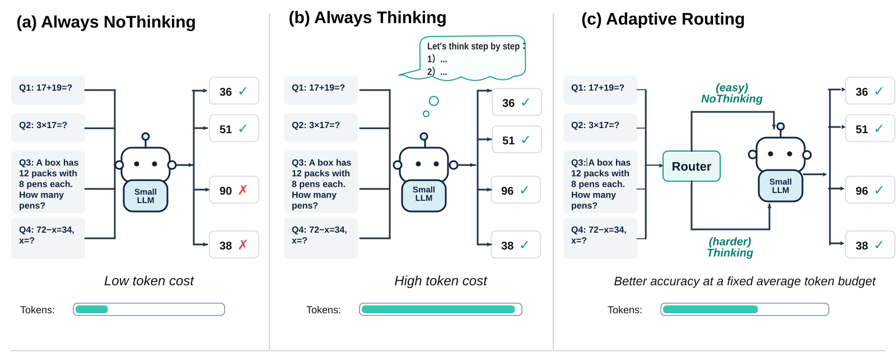

# AdaptThink — SC4001 Reproduction & Extension

<p align="center">
  
</p>

This is a course-project fork of **[AdaptThink: LLM Can Learn When to Think](https://arxiv.org/abs/2505.13417)**, originally developed by [THU-KEG](https://github.com/THU-KEG/AdaptThink).

For **NTU SC4001 Project G**, we investigate whether choosing **Thinking** or **NoThinking** before answering a mathematical question improves the accuracy–output-token trade-off:

**Maximize accuracy, subject to an average generated-output-token budget.**

Our main solver is **DeepSeek-R1-Distill-Qwen-1.5B**. The repository contains fixed-mode and random-routing baselines, external-router experiments using ModernBERT or frozen DeepSeek representations, and internal-routing SFT / small-scale RL experiments. External-router replay keeps the answer generator fixed; internal-model training and self-generation are separate experimental settings. This project is **not a claim to reproduce the original paper's full-scale RL training**.

## Navigation

- [Reproduction scope and artifact availability](#reproduction-scope-and-artifact-availability)
- [1. Environment and dependencies](#1-environment-and-dependencies)
- [2. Data preparation](#2-data-preparation)
- [3. Reproduce cached baselines on CPU](#3-reproduce-cached-baselines-on-cpu)
- [4. Reproduce external-router evaluation and figures](#4-reproduce-external-router-evaluation-and-figures)
- [5. Training and additional experiments](#5-training-and-additional-experiments)
- [6. Regenerate the fixed-mode baseline answers](#6-regenerate-the-fixed-mode-baseline-answers)
- [7. Evaluation conventions](#7-evaluation-conventions)
- [8. Reproduction records and submission artifacts](#8-reproduction-records-and-submission-artifacts)
- [Research documentation and attribution](#research-documentation-and-attribution)

## Reproduction scope and artifact availability

There are three different tasks: **recompute results from saved evidence**, **run trained routers**, and **retrain models / regenerate answers**. They do not have the same requirements.

| Task | What is available in Git | Additional requirements |
| --- | --- | --- |
| Recompute Random Router results and assemble canonical test labels | Baseline grades, split manifests, data and scripts | CPU environment; no model download |
| Recreate the three-external-router report and matched-budget figures | Reporting scripts and validation labels | Saved validation and test prediction files listed in Section 4; no GPU once predictions are available |
| Run the three trained external routers on test questions | Prediction scripts | Base model, trained heads / checkpoint, validation feature cache and reference predictions; GPU forwards, but no answer decoding |
| Retrain frozen-representation routers | Feature extraction and probe-fitting scripts | Original strict training labels and base model |
| Retrain every historical ModernBERT / cost-aware configuration | Some training and ablation scripts | Additional server-local trainers or artifacts; see Section 5 |
| Regenerate fixed-mode answers | Historical two-stage generation and scoring scripts | Base model, inference/scoring environment and GPU |
| Reproduce internal SFT / RL experiments | Training / evaluation entrypoints and selected result files | Matching training data, generated responses or exported checkpoints, and the experiment-specific environment |

**Current limitations, checked against `main` on 2026-11-13:** the original strict 3,000-question training JSONL, trained external-router artifacts, raw generation caches, and most `outputs/` / checkpoint directories are not included in the repository. The three-router test predictions and report are also not bundled. A fresh clone therefore supports the cached-baseline workflow, **not every end-to-end experiment without restoring additional files**. The commands below identify these prerequisites rather than silently substituting another dataset or checkpoint.

The instructions were checked against repository scripts and recorded experiment documentation. This README update does **not** constitute a fresh environment validation, GPU run, or independent replication of the reported numbers.

## 1. Environment and dependencies

### 1.1 Checkout and CPU environment

Commands below use **Bash on Linux** and run from the repository root. When using the submission ZIP, extract it and enter its root directory instead of cloning.

```bash
git clone https://github.com/miyaliao/AdaptThink.git
cd AdaptThink

python3.10 -m venv .venv
source .venv/bin/activate
python -m pip install --upgrade pip
python -m pip install numpy matplotlib

export PYTHONNOUSERSITE=1
export TOKENIZERS_PARALLELISM=false
```

`numpy` and `matplotlib` are sufficient for the CPU reporting / synthetic-test commands in Section 3. They are not a complete training environment. Their exact versions should be recorded with each reproduction run.

### 1.2 Recorded GPU environment

The project records the following core versions for its 1.5B inference / routing work. See [NTU inference environment](docs/NTU_HPC_ENV.md) and the [historical environment notes](https://github.com/miyaliao/AdaptThink/blob/4efc5e870c0b54908af347ae4379b8ae38d284da/README.md).

| Component | Recorded version / role |
| --- | --- |
| Python | 3.10 |
| PyTorch | 2.6.0+cu124 |
| Transformers | 4.51.2 |
| vLLM | 0.8.5, required for answer generation, not cached-result replay |
| Hugging Face Hub | 0.30.2 in the recorded H200 environment |
| Accelerate | 1.3.0 in the recorded H200 environment |
| PEFT | 0.14.0 for LoRA experiments |
| XFormers | 0.0.29.post2 in the recorded V100 inference environment |
| Math-Verify / SymPy | 0.9.0 / 1.13.1 in the later scoring environment notes |
| Other packages | `numpy`, `matplotlib`, `pylatexenc`; training-specific scripts may also require `datasets`, `pandas` and `scikit-learn` |

For a **new** environment, the following is a bootstrap based on those recorded core versions, **not a complete, freshly tested lockfile**. Preserve a working experiment environment rather than reinstalling it unnecessarily.

```bash
# CUDA 12.4 PyTorch build used in the recorded environment.
python -m pip install 'torch==2.6.0' \
  --index-url https://download.pytorch.org/whl/cu124

# Transformers-based feature extraction, router training and LoRA support.
python -m pip install \
  'transformers==4.51.2' 'huggingface-hub==0.30.2' \
  'accelerate==1.3.0' 'peft==0.14.0' \
  datasets pandas scikit-learn

# Additional dependencies only when generating / grading new answers.
python -m pip install \
  'vllm==0.8.5' 'math-verify==0.9.0' 'sympy==1.13.1' pylatexenc

python -m pip check
python -c "import torch, transformers; print(torch.__version__, transformers.__version__); print('CUDA available:', torch.cuda.is_available())"
```

**Do not treat [`requirements.txt`](requirements.txt) as the experiment lockfile.** It contains the broader development / upstream RL stack, includes unpinned dependencies, and specifies `vllm==0.8.2`, whereas the recorded baseline inference environment used `0.8.5`. The lightweight reproduction paths here do not require installing the entire RL stack. RL additionally depends on its launcher-specific `verl` / Ray environment; the commands above do not claim to provision that environment.

### 1.3 Hardware and scheduler settings

The baseline inference configuration was recorded on a **single V100 32 GB**; other generation and internal-model experiments used the lab **H200** environment. Preserve each experiment's recorded precision and backend. Do not merge FP16 and BF16 generations into one claimed reproduction.

For the recorded **V100 inference** path:

```bash
export VLLM_USE_V1=0
export VLLM_ATTENTION_BACKEND=XFORMERS
export TOKENIZERS_PARALLELISM=false
```

That path uses FP16 and disables chunked prefill. The H200 PBS launchers instead use their own BF16 / attention settings; do not copy them into V100 jobs. Generated-token cost does not include router forward-pass time or GPU memory.

Run GPU commands **inside an allocated compute job**, not on the HPC login node. The provided `.sbatch` / `.pbs` files contain site-specific paths, accounts and resources. In particular, several NTU launchers assume `/tc1home/UG/n2602710a/AdaptThink`. Adapt those settings to the executing machine before submission; the direct Python commands below avoid that hard-coded working-directory assumption.

### 1.4 Base model

GPU workflows expect a local model directory:

```text
model/DeepSeek-R1-Distill-Qwen-1.5B/
```

Restore the model and tokenizer used for the original experiment when reproducing saved heads. To obtain a model snapshot for a new run:

```bash
python - <<'PY'
from huggingface_hub import snapshot_download
snapshot_download(
    repo_id="deepseek-ai/DeepSeek-R1-Distill-Qwen-1.5B",
    local_dir="model/DeepSeek-R1-Distill-Qwen-1.5B",
)
PY
```

Record the resolved model revision and file hashes. The download above does not pin a historical revision and is not proof of byte-identical model/tokenizer provenance. The evaluation code checks prompt templates and historical validation predictions to detect mismatches. ModernBERT feature-extraction / training scripts use `answerdotai/ModernBERT-base`; evaluating the trained Utility-Hard router requires the **fine-tuned checkpoint**, not a fresh base ModernBERT model.

## 2. Data preparation

### 2.1 Use the frozen data and splits

Dataset JSON files and split manifests are already in the repository. **Do not resample the benchmark or regenerate the manifests to reproduce an existing result.**

| Split | Composition | Manifest |
| --- | --- | --- |
| Training manifest | 3,000 stratified DeepScaleR questions | `data/splits/sft_train_3000_seed42.json` |
| Validation | 300 GSM8K + 150 MATH-500 questions | `data/splits/adaptthink_val_seed142.json` |
| Canonical test | 330 GSM8K + 125 MATH-500 + all 30 AIME 2024 questions | `data/splits/adaptthink_original_baseline_seed42.json` |

Source files are under `data/test/` and `data/train/`. The released Thinking reference results are under `data/train/ref_results/`. On the canonical test, AIME has **16 generations per question per mode**, while GSM8K and MATH-500 have one. Thus there are **485 unique test questions, 935 generations per mode, and 1,870 across both modes**.

```bash
python scripts/verify_baseline_split.py
python scripts/check_split_quality.py
```

The second command audits the split manifests. It does not establish that every historical label variant has the same provenance or decontamination properties. The external-router strict-data loader separately checks its original files and reports normalized train/validation text overlaps without removing rows.

### 2.2 Keep label variants separate

| File / directory | Purpose and availability |
| --- | --- |
| `results/val_450_labels.jsonl` | Committed strict validation outcomes for external-router replay |
| `results/router_labels_1p5b/all_3000_labels.jsonl` | **Original strict training labels; not committed.** Restore the exact experiment file. The directory currently contains summary / checksum information. |
| `results/router_labels_1p5b_repaired/all_3000_labels.jsonl` | Committed repaired variant; default input to the current internal SFT script |
| `results/router_labels_1p5b_compliant/all_3000_labels.jsonl` | A separate committed variant, not an interchangeable strict-label replacement |
| `results/baseline_1p5b/{thinking,nothinking}_grades.json` | Committed paired baseline grades used for test replay |

External-router historical experiments use empirical success rates from Thinking reference samples (`K >= 16`) and four NoThinking samples per training question. Classification uses `1[p_N >= p_T]`, including ties in NoThinking. Utility-aware targets use

```text
DeltaU_N = (p_N - p_T) + lambda * (t_T - t_N) / 1000
```

where `p` is empirical correctness and `t` is mean generated-output-token count. Hard targets threshold `DeltaU_N`; soft targets apply a sigmoid with temperature; direct utility regression predicts the continuous gap. The target definition and label variant must match the experiment being reproduced.

After restoring the **original strict** training JSONL, verify it before training:

```bash
python scripts/route_e_frozen.py check-data
```

The loader requires these SHA256 values:

```text
results/router_labels_1p5b/all_3000_labels.jsonl
761dcbb6338de1a3c71def382089c83e8024e0e55af6334dd974963e8d7e0f2c

results/val_450_labels.jsonl
4c1e984d3744cc089dcc963a30af0ef3d1ed9808c4bfd245a97e48787d501461
```

Do **not** bypass a hash failure or rename a repaired/compliant file to the strict path.

For reconstruction from the **original archived raw NoThinking generation shards and metadata**, the scoring entrypoint is:

```bash
python scripts/build_router_labels.py \
  --input-dir outputs/nothinking_train_seed42 \
  --output-dir results/router_labels_1p5b \
  --workers 8 --all
```

This requires the missing raw generation cache and the scoring dependencies; it is not a fresh-clone shortcut. Check the resulting strict-file hash. Generating new samples, changing the scorer, or using another precision/backend is a new data-production run, not a guaranteed reconstruction of the historical file. See [`lab_score_labels.pbs`](scripts/lab_score_labels.pbs) and [`gen_nothinking_train.py`](scripts/gen_nothinking_train.py) for the generation/scoring workflow.

### 2.3 Assemble test replay labels without generating answers

```bash
python scripts/build_test_labels.py
```

Expected outputs:

```text
results/test_485_labels.jsonl
results/test_485_summary.json
```

This reshapes the **committed** paired grades into question-level outcomes and averages AIME's 16 draws within each question. It does not run the LLM or re-grade responses. Test outcomes are evaluation evidence, never router inputs or training targets.

## 3. Reproduce cached baselines on CPU

After Section 1.1, run:

```bash
python scripts/verify_baseline_split.py
python scripts/build_test_labels.py
python scripts/eval_random_router.py

# Synthetic checks of the reporting / score-replay implementation.
python scripts/adaptthink_test_predict.py --stage self-test
python scripts/adaptthink_test_report.py --self-test
python scripts/plot_test_matched_budget.py --self-test
```

For Random Router without a plot, use `python scripts/eval_random_router.py --skip-plot` instead. These commands do not require downloaded model weights, trained router checkpoints or new LLM generation. Run in a clean working copy or preserve existing result files before rerunning scripts that write to their default output paths.

Random Router defaults evaluate NoThinking probabilities `0.10`, `0.25` and `0.50`, with 100 router seeds starting at 42, plus the fixed-mode endpoints. Each AIME question receives one routing decision shared by its 16 draws. Outputs are:

```text
results/random_router_1p5b/summary.json
results/random_router_1p5b/per_seed.json
results/random_router_1p5b/accuracy_tokens.png
```

The fixed-mode reference results are already recorded in [`results/baseline_1p5b/summary.json`](results/baseline_1p5b/summary.json):

| Dataset | NoThinking accuracy | Thinking accuracy | NoThinking tokens | Thinking tokens |
| --- | ---: | ---: | ---: | ---: |
| GSM8K, 330 questions | 66.06% | 77.88% | 269 | 924 |
| MATH-500, 125 questions | 67.20% | 84.80% | 856 | 3,964 |
| AIME 2024, 30 questions × 16 draws | 10.83% | 25.00% | 6,013 | 12,489 |

Tokens are mean generated-output tokens, rounded here. Cached replay can reproduce computations on this fixed evidence; it does **not** independently reproduce model generation. Random-router seed variability is not a confidence interval over new test questions.

## 4. Reproduce external-router evaluation and figures

The implemented three-router workflow is documented in [`docs/README_three_router_test.md`](docs/README_three_router_test.md). It compares:

| Representative | Representation / routing score |
| --- | --- |
| ModernBERT + Utility-Hard | Full-fine-tuned ModernBERT; NoThinking preference probability |
| Frozen DeepSeek P1 + Classification | Assistant-prefix final hidden state; logistic NoThinking score |
| Frozen DeepSeek P1 + Cost-only | The same P1 representation; Ridge-predicted Thinking-minus-NoThinking token cost |

**Configuration identity matters:** this test runner's archived Utility-Hard representative is **lambda = 0.02**. The later utility sweep selected a different ModernBERT Hard candidate, **lambda = 0.01**, on validation. They are different experimental configurations. Do not silently substitute the sweep winner into the existing three-router comparison. Freeze and document any new comparison separately.

### 4.1 Restore the required artifacts

For GPU prediction, restore the following paths from the corresponding experiment archive, in addition to the base model:

```text
outputs/external_modernbert/utility_ablation/utility_hard_lam0.02/
  best_model/
  validation_predictions.jsonl

outputs/route_e/prompt_ablation/assistant/full/
  linear_probe.npz
  val.npz
  validation_p_nt.json

outputs/route_e/token_aware/full/
  ridge_heads.npz
  validation_predictions.json
```

The checkpoint directory must contain the model/config/tokenizer files required by its loader. Use the actual saved best checkpoint if its server-side directory differs. These paths are **not downloadable artifacts supplied by this README**; they must be included in the submission package or provided through a separately documented artifact archive.

### 4.2 Verify artifacts and predict routing scores

```bash
python scripts/verify_baseline_split.py
python scripts/build_test_labels.py
python scripts/adaptthink_test_predict.py --stage self-test
python scripts/adaptthink_test_report.py --self-test
python scripts/adaptthink_test_predict.py --stage verify
```

The verification stage checks that the restored P1 / cost heads reproduce the stored validation scores. GPU prediction additionally checks representation/checkpoint consistency. A mismatch is a stop condition, not a reason to relax the tolerance until the test runs.

Inside an allocated GPU job:

```bash
UTILITY_MODEL=outputs/external_modernbert/utility_ablation/utility_hard_lam0.02/best_model

python scripts/adaptthink_test_predict.py --stage deepseek
python scripts/adaptthink_test_predict.py \
  --stage modernbert --utility-model "$UTILITY_MODEL"
```

On the original NTU setup, the equivalent scheduler entrypoint is:

```bash
sbatch --export=ALL,UTILITY_MODEL=outputs/external_modernbert/utility_ablation/utility_hard_lam0.02/best_model \
  scripts/ntu_three_router_test.sbatch
```

That wrapper also runs verification and the standard report. Adapt its site-specific working directory before using another account. Predictions require model forward passes but **do not decode new LLM answers**. The principal outputs are:

```text
outputs/test_485/deepseek_p1_features.npz
outputs/test_485/p1_predictions.json
outputs/test_485/cost_predictions.json
outputs/test_485/utility_predictions.jsonl
```

### 4.3 Recreate the report, curves and paper-style tables

With the three test prediction files above, the three corresponding validation prediction files, and the label files restored, this stage is CPU-only:

```bash
python scripts/adaptthink_test_report.py --main-budget 1300
python scripts/plot_test_matched_budget.py --budget 1300
```

Outputs are written under `results/test_485_three_routers/`, including:

| Output | Purpose |
| --- | --- |
| `heldout_test_report.md`, `test_per_dataset_table.csv` | Standard report and per-dataset comparison |
| `test_threshold_overlay.png/.svg` | Descriptive test threshold-sweep curves |
| `test_validation_budget_transfer.png/.svg`, `validation_budget_transfer.csv` | Validation-calibrated thresholds applied unchanged on test |
| `nauc_ac_test.csv`, `provenance.json` | Curve metric and artifact / protocol provenance |
| `matched_test_budget_curve.csv` | Accuracy at matched measured test-token budgets |
| `thinkswitcher_style_val_B1300.*` | Table using validation-selected operating points |
| `thinkswitcher_style_testmatched_B1300.*` | Descriptive table using test-cost matching |
| `matched_budget_B1300_policy_audit.json` | Records the two table policies and their distinction |

The table files include Markdown, CSV, LaTeX and rendered figures. The default supplementary budget grid is 900, 1,100, 1,300, 1,500, 1,700, 1,900 and 2,100 tokens.

**Do not confuse the two comparisons.** A threshold selected for a validation target of 1,300 tokens can produce a different actual cost on test; this is not a guaranteed hard deployment budget. Matching or interpolating at 1,300 **measured test tokens** is a useful descriptive comparison, but it is not a threshold chosen without test outcomes. Keep the corresponding figure/table labels explicit.

## 5. Training and additional experiments

These commands are for rebuilding models or investigating ablations, not prerequisites for CPU replay when the exact saved predictions are available. A retraining run should save its own provenance and must not be assumed to reproduce an archived checkpoint byte-for-byte.

### 5.1 Frozen DeepSeek representation and P1 classification

Prerequisites: original strict 3,000/450 labels, the local DeepSeek model and the GPU feature-extraction environment. Run the P0 reference before the P1 prefix ablation, as in the provided launchers:

```bash
python scripts/route_e_frozen.py self-test
python scripts/route_e_frozen.py check-data
python scripts/route_e_prompt_ablation.py inspect-template

# P0: assistant + <think> representation.
python scripts/route_e_frozen.py extract --encoder deepseek
python scripts/route_e_frozen.py fit --encoder deepseek

# P1: assistant prefix without the <think> suffix.
python scripts/route_e_prompt_ablation.py extract --prompt-mode assistant
python scripts/route_e_prompt_ablation.py fit --prompt-mode assistant
```

For a small pipeline check, use `--smoke` consistently on the corresponding `extract` and `fit` commands. Smoke runs use 32 training and 24 validation examples; **they are not the reported full experiment**. Full P1 artifacts go to `outputs/route_e/prompt_ablation/assistant/full/`, with validation reports under `results/route_e/prompt_ablation/`.

The frozen ModernBERT control uses `route_e_frozen.py extract/fit --encoder modernbert`. The P2 question-only ablation uses `route_e_prompt_ablation.py extract/fit --prompt-mode user_only`. Prefix choice is part of **representation extraction**, not a replacement definition of the solver's Thinking/NoThinking generation modes.

### 5.2 Utility-objective ablations and availability boundaries

See [Route A objectives and results](docs/ROUTE_A_PLAN.md) and [Route E research](docs/ROUTE_E_RESEARCH.md) for the original five quality objectives, representation ablations, cost-aware scores and utility targets. Compact validation sweep data are committed under [`results/route_a/utility_objective/`](results/route_a/utility_objective/).

For direct utility regression on already extracted frozen P1 features:

```bash
python scripts/utility_original_ablation.py self-test
python scripts/utility_original_ablation.py train --encoder p1
python scripts/utility_original_ablation.py evaluate --encoder p1
python scripts/compare_utility_objectives.py --encoder p1
```

The comparison command also needs the previous objective results described by the experiment documentation. New direct-regression outputs are kept separately under `outputs/route_e/p1_utility_original/` and `results/route_a/utility_original/p1/`.

Two important gaps prevent presenting every historical model as a one-command fresh-clone training run:

- The historical ModernBERT Utility-Hard/Soft sweep depends on server-local `scripts/train_modernbert_utility.py`, which is not currently in `main`. Restore that exact trainer and configuration or use the archived trained checkpoint; the sweep wrapper alone is insufficient.
- The original P1 cost-only training implementation was recorded on `feature/route-e-token-aware-20261103`, not as a standalone trainer in `main`. The test runner can apply and verify the saved `ridge_heads.npz`, but that does not supply the missing training workflow.

Do not describe the direct-Utility regression runner as reproducing the Utility-Hard classifier; their targets and losses differ.

### 5.3 Internal SFT and RL are separate workflows

The current internal SFT entrypoint is **[`scripts/train_router_sft.py`](scripts/train_router_sft.py)**. Some historical notes refer to an older `train_decision_lora.py` name; use the actual checked-in script. It supports decision supervision plus NoThinking-answer supervision and a decision-only loss setting.

An explicit invocation of the current default SFT configuration, using the external 450-question validation file rather than its fallback split, is:

```bash
python scripts/train_router_sft.py \
  --model model/DeepSeek-R1-Distill-Qwen-1.5B \
  --labels results/router_labels_1p5b_repaired/all_3000_labels.jsonl \
  --nothinking-dir outputs/nothinking_train_repaired \
  --val-labels results/val_450_labels.jsonl \
  --lam 0.02 --temperature 0.25 --response-weight 1.0 \
  --epochs 2 --batch-size 4 --lr 1e-4 --seed 42 \
  --output-dir outputs/lora_router_sft
```

This requires the repaired **response cache**, not just repaired labels. It produces an adapter and `train_report.json`. Setting `--response-weight 0` changes the loss to decision-only, but the current script still loads the response directory. This invocation documents current defaults; it is not asserted to be the configuration of every historical internal-router result. The script uses BF16 when supported and otherwise FP32, so do not assume it uses the V100 baseline's FP16 inference settings.

Small-scale RL / checkpoint utilities are [`run_rl_small.py`](scripts/run_rl_small.py), [`lab_rl_small.pbs`](scripts/lab_rl_small.pbs), [`merge_fsdp_ckpt.py`](scripts/merge_fsdp_ckpt.py), and [`eval_free_choice.py`](scripts/eval_free_choice.py). An exported model directory, rather than a bare LoRA adapter, is needed by the latter's model-loading path.

For example, with the corresponding checkpoint already exported on the H200 setup:

```bash
python scripts/eval_free_choice.py \
  --model checkpoints/sc4001_rl_bal/global_step_300/hf \
  --labels results/val_450_labels.jsonl \
  --mode free --samples 1 --max-tokens 4096 --dtype bfloat16 \
  --out results/rl_free_choice_free_reproduction.json
```

Use `--mode fast` or `--mode think` for its forced-mode controls, keeping the other settings and output filenames explicit. **This evaluates validation questions and generates new responses with a 4,096-token cap.** Its forced-thinking path injects `Alright`; it is not the same protocol as the frozen-model 16,384-token canonical test replay. Keep these results separate unless a new, explicitly matched evaluation is performed. The internal RL training environment and exact run configuration still need to accompany any corresponding final-report claim.

## 6. Regenerate the fixed-mode baseline answers

This is the expensive GPU path; it is unnecessary for Sections 3–4 when replaying the committed grades. Use the recorded V100 inference/scoring environment and preserve the model/tokenizer, seeds, precision and sampling protocol. The historical baseline uses temperature 0.6, top-p 0.95, top-k -1 and a 16,384-token response limit, with natural EOS and the script's NoThinking prefix accounting.

The existing baseline was produced in **two stages**: first the original subset containing eight AIME questions, then the remaining 22 AIME questions. The second script depends on the first stage's saved manifest and responses. Run both stages, not the subset script alone, to obtain the canonical all-30-AIME result.

Inside an allocated GPU job, from the repository root:

```bash
# Stage 1: 330 GSM8K + 125 MATH-500 + the historical 8-question AIME subset.
python scripts/eval_baseline_subset.py --action preflight
python scripts/eval_baseline_subset.py --action generate --mode nothinking
python scripts/eval_baseline_subset.py --action generate --mode thinking
python scripts/eval_baseline_subset.py --action score

# Stage 2: add the remaining 22 AIME questions, then combine all 30.
python scripts/extend_aime_full.py --action preflight
python scripts/extend_aime_full.py --action generate --mode nothinking
python scripts/extend_aime_full.py --action generate --mode thinking
python scripts/extend_aime_full.py --action score
```

The corresponding NTU launchers are [`ntu_baseline_subset.sbatch`](scripts/ntu_baseline_subset.sbatch) and [`ntu_aime_full.sbatch`](scripts/ntu_aime_full.sbatch). Complete and verify the first stage before launching the second.

Outputs are under `outputs/baseline_subset_25pct_seed42/` and `outputs/baseline_aime_remaining_seed42/`; the latter's **`summary_combined.json`** is the combined baseline summary. Raw generation/scoring outputs are not automatically a replacement for the normalized committed replay inputs in `results/baseline_1p5b/`. Preserve the existing benchmark evidence and validate IDs, schema and provenance before building a new replay dataset.

Scoring uses [`src/adapt_think_rm.py`](src/adapt_think_rm.py). Do not replace strict evaluation with answer-format repair while claiming to reproduce the same baseline. Hardware / kernel changes can also change sampled generations; exact cached-result replay and fresh model execution are different levels of reproduction.

## 7. Evaluation conventions

**Selection:** use training data for fitting and validation for checkpoint, objective/hyperparameter and threshold selection. Freeze the configuration before held-out evaluation. Test sweeps are descriptive analyses, not permission to choose a new test-optimal model or operating point.

**Cost:** reported routing curves measure generated-output tokens. Router encoding, prefill, training, wall-clock latency and memory are not included unless separately measured. Token savings alone are not an end-to-end speedup claim.

**Aggregation:** aggregate AIME's 16 draws within each question before pooled question-level comparisons. A three-dataset macro average and a pooled average over 485 questions are different quantities; report them separately.

**Budget matching:** equal NoThinking percentages do not guarantee equal token costs. Global Random is an expected fixed-probability reference at a matched measured cost. Validation-calibrated threshold transfer and descriptive test-cost interpolation must remain separately labeled.

**Metrics:** the reporting code's raw nAUC-AC integrates accuracy advantage over the cost-matched Random reference in accuracy-fraction × token units. Its `mean_gain_pp` normalizes by the cost span. Do not directly compare raw nAUC values across different token spans or datasets as though they were percentages.

**Uncertainty and provenance:** validation exploration is not held-out evidence, random-router seeds do not quantify dataset uncertainty, and synthetic self-tests do not validate missing experiment artifacts. Preserve strict/repaired labels, generation limits and checkpoint identities in any cross-method comparison.

## 8. Reproduction records and submission artifacts

For each reported experiment, retain the exact command, selected configuration, source revision, dependency versions, model/checkpoint hashes, data hashes and output paths. For a Git checkout:

```bash
mkdir -p reproduction_record
git rev-parse HEAD > reproduction_record/git_commit.txt
python --version > reproduction_record/python_version.txt
python -m pip freeze > reproduction_record/pip_freeze.txt
sha256sum results/val_450_labels.jsonl \
  data/splits/adaptthink_original_baseline_seed42.json \
  > reproduction_record/data_checksums.sha256
# Run on the allocated GPU node for GPU experiments:
nvidia-smi > reproduction_record/nvidia_smi.txt
```

A submission ZIP made only from tracked Git files will **not** include the server-local artifacts listed above. To make a final-report result independently reproducible, package its required small inputs / predictions / heads and give an accessible, versioned location for any large weights or generation caches that cannot be included. Do not include virtual environments, access tokens, SSH keys or unrelated cluster files.

Before final submission, resolve the remaining experiment-specific gaps: the strict training JSONL for historical external training; missing trainers for any training result selected for the report; exact trained checkpoints and their hashes; saved validation/test predictions for report-only reproduction; and a tested environment record. Exercise the selected commands from the actual submission package, not merely from a populated research server. Source-code commenting and the final choice of submitted code remain a separate packaging task; this README does not claim that review is complete.

## Research documentation and attribution

| Document / directory | Contents |
| --- | --- |
| [Route A](docs/ROUTE_A_PLAN.md) | External-router objectives, validation results and utility studies |
| [Route E](docs/ROUTE_E_RESEARCH.md) | Frozen representations, prompt prefixes and downstream routing |
| [Three-router evaluation](docs/README_three_router_test.md) | Artifact contracts, held-out evaluation and reporting protocol |
| [Route B](docs/ROUTE_B_PLAN.md) | Historical internal-router design and label-generation rationale; some planned filenames are superseded by current scripts |
| [NTU environment](docs/NTU_HPC_ENV.md) | Recorded inference setup, benchmarks and historical baseline procedure |
| [Utility result tables](results/route_a/utility_objective/) | Compact archived validation sweep results |
| [Historical README](https://github.com/miyaliao/AdaptThink/blob/4efc5e870c0b54908af347ae4379b8ae38d284da/README.md) | Earlier label-repair tables, calibration discussion and cluster notes retained in Git history |

The original AdaptThink method, upstream training infrastructure and released reference data belong to their respective authors. Please credit the [AdaptThink paper](https://arxiv.org/abs/2505.13417), [THU-KEG repository](https://github.com/THU-KEG/AdaptThink), the base-model authors and the benchmark creators when using this work. See [LICENSE](LICENSE) for this repository's license; models and datasets retain their own terms.
