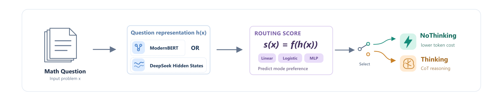
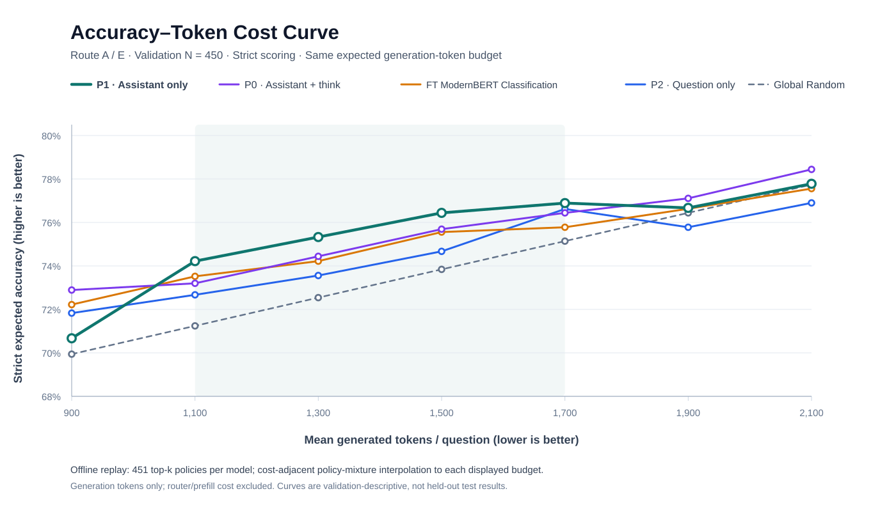

# Route A — External Router via ModernBERT

<p align="center">
  
</p>


Status: **five Route A Router objectives evaluated as of 2026-11-02**, followed by **Route E frozen-representation, prompt-prefix, and token-aware routing validation experiments on 2026-11-03** (Section 8). Within the original five objectives, Classification had the strongest reported cost-matched uplift; Route E results are analyzed separately at common output-token budgets. SC4001 deadline: **2026-11-16**.

## 1. Research question

Can a lightweight **external router**, seeing only the problem text *before* generation, improve the accuracy–output-token trade-off by selecting **Thinking** or **NoThinking** for a frozen `DeepSeek-R1-Distill-Qwen-1.5B`?

- Objective: maximize answer accuracy under a mean output-token budget.
- No DeepSeek weight updates; no generated answers, ground-truth answers, or actual future token counts used as router input.
- Compare routes at **the same measured mean output-token cost**, not merely the same NoThinking share.
- Router compute and latency overhead are **not included** in the tables below; report them separately before making an end-to-end efficiency claim.

## 2. Shared data and evaluation

| Item | Protocol |
| --- | --- |
| Router encoder | `answerdotai/ModernBERT-base`, full fine-tuning |
| Training | 3,000 DeepScaleR problems, `results/router_labels_1p5b/all_3000_labels.jsonl` |
| Training targets | Empirical success rates: Thinking `K >= 16`, NoThinking `K = 4` |
| Validation | 450 problems: GSM8K 300 + MATH-500 150, `results/val_450_labels.jsonl` |
| Unused held-out test | GSM8K 330 + MATH-500 125 + AIME 2024 30 (16 generations/problem) |
| Scoring | Strict `src/adapt_think_rm.py`; no repaired-label substitution |
| Offline evaluation | Replay cached paired Thinking/NoThinking generations; do not regenerate |
| Baselines | Always Thinking; Always NoThinking; budget-matched Global Random |

Always Thinking: **78.44%**, **2,209 tokens/problem**.  
Always NoThinking: **67.78%**, **568 tokens/problem**.

The observed uplift in the tables means **accuracy minus the expected accuracy of Global Random at the same measured mean output-token budget**, in percentage points (pp). It is **not** improvement over Always Thinking.

## 3. Five completed methods

| Method | Prediction / supervision | Training loss | Best checkpoint/epoch | Best validation loss | Finding |
| --- | --- | --- | --- | ---: | --- |
| **Classification** | Binary label `1[p_N >= p_T]` (ties → NoThinking) | Cross-Entropy | Epoch 2 | 0.7146 | **Strongest observed cost-matched uplift** |
| Dual Regression (BCE) | `[p_T, p_N]` | Soft-label BCE | Epoch 4 | 0.6727 | Limited uplift |
| Delta Regression | `delta = p_T - p_N` | MSE | Epoch 1 | 0.21987 | Below matched Random at all intermediate points measured |
| **Dual MSE** | `[p_T, p_N]`, sigmoid bounded | Dual MSE | `checkpoint-752` | 0.247712 | Positive uplift, particularly at 75% NoThinking |
| **Dual MSE + Margin** | `[p_T, p_N]` and their difference | Dual MSE + 1.0 × Margin MSE | `checkpoint-564` | 0.492873 | Improved some budget regions, not uniformly better than Dual MSE |

Dual MSE and Margin were trained with the original strict 3,000-question file, not the repaired 3,000 or compliant 2,777 versions. Both use seed 42, ModernBERT-base full fine-tuning, batch 16, LR `2e-5`, up to 5 epochs and the same 450-question strict validation replay. Their job `71767` finished **COMPLETED (0:0)** in **00:07:45**. The best checkpoint was selected on each model's own validation objective.

**Do not compare validation loss magnitudes across the rows:** the target and loss functions differ.

Delta run configuration: LR `2e-5`, batch `16`, max `5` epochs, seed `42`, FP16; best checkpoint `checkpoint-188`. Earlier Classification/Dual run settings should be checked against their server-side run metadata rather than assumed identical.

### Utility-aware supervision ablation (2026-11-05)

Four **training targets** were compared on the same strict 3,000-train / 450-validation protocol. All predict the preference for NoThinking: **Classification** uses `1[p_N >= p_T]`; **Utility-Hard** uses `1[ΔU_N >= 0]`; **Soft-NoCost** uses `sigmoid((p_N-p_T)/τ)`; **Utility-Soft** uses `sigmoid(ΔU_N/τ)`, where `ΔU_N = (p_N-p_T) + λ(t_T-t_N)/1000`, **λ = 0.02**, **τ = 0.25**. Here `p` denotes strict empirical success rate and `t` mean generated tokens.

**ModernBERT (full fine-tuning; Classification is the control from this utility-ablation run, not the original five-method checkpoint):**

| Output-token budget | Classification | Utility-Hard | Soft-NoCost | Utility-Soft |
| ---: | ---: | ---: | ---: | ---: |
| 900 | 70.00% | 70.44% | **72.22%** | 70.22% |
| 1,100 | 70.89% | **72.22%** | **72.22%** | 71.56% |
| 1,300 | 72.01% | 73.33% | **74.00%** | 72.44% |
| 1,500 | 72.96% | **74.44%** | 73.77% | 74.00% |
| 1,700 | 74.44% | **74.89%** | 74.67% | 74.12% |
| 1,900 | 76.00% | **77.78%** | 76.00% | 75.42% |
| 2,100 | 77.58% | **78.22%** | 77.46% | 75.56% |

**DeepSeek P1 (frozen final-layer 1,536-d assistant-prefix representation; Logistic head, BCE + L2):**

| Output-token budget | Classification | Utility-Hard | Soft-NoCost | Utility-Soft |
| ---: | ---: | ---: | ---: | ---: |
| 900 | 70.67% | **73.56%** | 69.56% | 69.56% |
| 1,100 | **74.22%** | 72.89% | 71.56% | 73.33% |
| 1,300 | **75.33%** | 74.74% | 73.11% | 74.89% |
| 1,500 | **76.44%** | 75.88% | 75.78% | 76.00% |
| 1,700 | 76.89% | 76.74% | **77.27%** | 77.20% |
| 1,900 | 76.67% | 77.78% | 77.69% | **77.92%** |
| 2,100 | 77.78% | 77.56% | **78.22%** | 78.00% |

The historical P1 Classification probe was reused and verified (**76.4444% at 50% NoThinking, 1,427.05 tokens; max prediction-score difference `1.5e-6`**). **Finding:** ModernBERT Utility-Hard exceeded its own Classification control at all seven budgets, but P1 showed **no consistent utility gain**: Utility-Hard gained **+2.89 pp at 900**, while the original P1 Classification led at **1,100–1,500**. These are exploratory **cost-matched validation accuracies** from offline replay/interpolation, not held-out test or significance results; router/encoder compute is excluded. ModernBERT full fine-tuning versus frozen P1 also prevents attributing cross-encoder differences solely to the representation.

### P1 Utility lambda sensitivity (protocol; not yet run, 2026-11-06)

[CPU-only sweep script](../scripts/p1_utility_lambda_sweep.py) reuses the **original strict 3,000/450 labels** and **cached frozen DeepSeek P1 features**. It evaluates Utility-Hard and Utility-Soft at predeclared `λ ∈ {0, 0.005, 0.01, 0.02, 0.05, 0.10}`, fixing `τ = 0.25`, Logistic `L2 = 1e-3`, and LBFGS `max_iter = 200`. For Utility-Hard at `λ=0`, it reuses the verified historical P1 Classification scores; it also keeps the prior P1 Cost-only reference.

Run from the repository root: `python scripts/p1_utility_lambda_sweep.py self-test`, then `python scripts/p1_utility_lambda_sweep.py run`. Outputs are **server-local** under `results/route_e/p1_utility_lambda_sweep/`: per-λ predictions/heads, **451-policy** `all_451_threshold_policies.csv`, `nauc_ac_lambda_sweep.csv`, `fixed_budget_accuracy.csv`, and figures. The primary metric is **nAUC-AC over the full shared output-token interval**, using the same cost-sorted integration convention as `scripts/compute_nauc_ac.py`; the seven fixed budgets are supplementary. The best λ selected on these 450 validation rows is *exploratory only* and must be frozen before independent test evaluation. No results are claimed here before TC1 execution.

### Main comparison: routing 50% of validation questions to NoThinking

| Router | Accuracy | Mean output tokens | Uplift vs cost-matched Random |
| --- | ---: | ---: | ---: |
| **Classification** | **73.56%** | **1,092** | **+2.37 pp** |
| Dual Regression | 73.11% | 1,363 | +0.16 pp |
| Delta Regression | 72.00% | 1,610 | -2.55 pp |
| Dual MSE | 72.89% | 1,295 | +0.39 pp |
| Dual MSE + Margin (beta=1) | 72.89% | 1,180 | +1.13 pp |

**Important:** all five choose 50% of questions for NoThinking, but they select different questions and therefore **use different token budgets**. The uplift column uses each method's *own* budget-matched Random reference. Do not compare raw accuracy at 50% share as if the compute were equal.

### Full validation sweep

| Router | NoThinking share | Accuracy | Mean output tokens | Uplift vs budget-matched Random |
| --- | ---: | ---: | ---: | ---: |
| Classification | 10% | 77.11% | 1,959 | +0.29 pp |
| Classification | 25% | 75.56% | 1,542 | +1.45 pp |
| **Classification** | **50%** | **73.56%** | **1,092** | **+2.37 pp** |
| Classification | 75% | 70.22% | 835 | +0.70 pp |
| Dual Regression | 10% | 77.33% | 2,034 | +0.03 pp |
| Dual Regression | 25% | 75.33% | 1,747 | -0.11 pp |
| Dual Regression | 50% | 73.11% | 1,363 | +0.16 pp |
| Dual Regression | 75% | 70.44% | 934 | +0.29 pp |
| Delta Regression | 10% | 77.33% | 2,122 | -0.55 pp |
| Delta Regression | 25% | 76.22% | 1,977 | -0.72 pp |
| Delta Regression | 50% | 72.00% | 1,610 | -2.55 pp |
| Delta Regression | 75% | 70.44% | 1,088 | -0.72 pp |
| Dual MSE | 10% | 77.33% | 2,005 | +0.22 pp |
| Dual MSE | 25% | 75.11% | 1,677 | +0.13 pp |
| Dual MSE | 50% | 72.89% | 1,295 | +0.39 pp |
| **Dual MSE** | **75%** | **71.33%** | **874** | **+1.57 pp** |
| Dual MSE + Margin | 10% | 77.33% | 2,016 | +0.15 pp |
| Dual MSE + Margin | 25% | 75.33% | 1,620 | +0.72 pp |
| **Dual MSE + Margin** | **50%** | **72.89%** | **1,180** | **+1.13 pp** |
| Dual MSE + Margin | 75% | 70.22% | 832 | +0.73 pp |

NoThinking shares 0% and 100% recover the fixed-mode endpoints above. The tables round accuracy/tokens for readability; full-precision source values are in the NTU job logs and server-local `results/external_modernbert/{dual_mse,dual_margin}_val.json` files.

## 4. Interpretation and limits

1. **Classification is the current validation leader**, with a maximum observed uplift of **+2.37 pp** over budget-matched Global Random. This is a validation observation, **not a held-out test result**.
2. The old Dual BCE has little observed uplift; Delta MSE is below matched Random at every intermediate point measured. **Dual MSE and Dual MSE + Margin both improve over matched Random at the measured intermediate points**, but neither clearly dominates the existing Classification curve.
3. **Margin effect is budget-dependent.** At 50% NoThinking, Dual MSE and Margin have the **same 72.89% accuracy**, but Margin uses **1,180 vs 1,295 tokens** (about 8.9% fewer); matched-Random uplift rises from **+0.39 to +1.13 pp**. At 75% NoThinking, however, **Dual MSE is better** (+1.57 vs +0.73 pp), so the margin term does not establish a uniform improvement.
4. Classification preferentially routes many MATH questions to NoThinking. MATH Thinking responses are much longer, so some overall benefit may come from **dataset-level cost allocation**, not necessarily finer problem-level prediction. This has not been isolated.
5. The 3,000 training examples are stratified by Thinking success rate and differ from validation difficulty. NoThinking training targets use only four samples and are noisy; empirical ties are common. The strict grader counts format failures.
6. Validation has only one cached generation per mode/problem. Keep the test set untouched while choosing objectives, checkpoints, or thresholds.

## 5. Completed ablation and research decision

The margin experiment was completed **2026-11-02** under Slurm job **71767**:

```text
L_dual   = 0.5 * [(pT_hat - pT)^2 + (pN_hat - pN)^2]
L_margin = [(pT_hat - pN_hat) - (pT - pN)]^2
L_total  = L_dual + beta * L_margin; beta = 1.0
```

The **Dual MSE-only control** isolates the BCE → MSE change from the added margin term. At a common *50% routed NoThinking share*, Margin saves about 115 average output tokens per question while maintaining the same measured accuracy. But this does **not** establish dominance at a common mean-token budget, and at 75% NoThinking the control has a larger uplift. **The existing Classification model remains the most promising Route A approach observed on validation**, with a recorded +2.37 pp cost-matched Random uplift at 1,092 tokens.

**Decision:** keep all five approaches as baselines. Do not launch a large margin-β sweep now. Next investigate **frozen DeepSeek-R1-Distill-Qwen-1.5B prompt hidden-state embeddings with a lightweight classifier/probe**, and compare against ModernBERT on the **same original strict training/validation protocol**, avoiding the teammate's repaired/compliant data during this ablation. Report Router overhead separately. Neither the canonical test split nor any test labels should be used for tuning.

Implementation: [training/evaluation script](../scripts/train_modernbert_margin.py) and [single-V100 Slurm script](../scripts/ntu_modernbert_margin.sbatch). Job 71767 completed in 00:07:45 (exit 0:0); Dual MSE best `checkpoint-752` (`eval_loss=0.247712`) and Dual Margin best `checkpoint-564` (`eval_loss=0.492873`). Checkpoint selection used each objective's own validation loss, so these two numeric losses are not directly comparable.

## 6. Reproducing Route A experiments on NTU TC1

Full-fine-tuning environment: `answerdotai/ModernBERT-base`, FP16, one V100-32GB; learning rate `2e-5`, batch 16, 5 epochs, max input 512, seed 42. Dual MSE and Dual MSE + Margin also use weight decay 0.01, warmup ratio 0.1, linear schedule, and select the lowest-validation-objective checkpoint. Both predict bounded probabilities via a sigmoid over two logits; the NoThinking decision selects the lowest predicted `pT - pN` at each target share. The earlier Delta Regression uses one output and MSE.

**Original strict label data (do not substitute repaired/compliant files).**

- Training: `results/router_labels_1p5b/all_3000_labels.jsonl` (3,000 questions), SHA256 `761dcbb6338de1a3c71def382089c83e8024e0e55af6334dd974963e8d7e0f2c`.
- Validation: `results/val_450_labels.jsonl` (450 questions), SHA256 `4c1e984d3744cc089dcc963a30af0ef3d1ed9808c4bfd245a97e48787d501461`. Use `p_nothinking_strict` when present.
- GitHub `main` no longer tracks the original strict training JSONL; it was retained in historical commit `b812deda`. Job 71767 used the original file restored on the server. `results/router_labels_1p5b_repaired/` (3,000) and `results/router_labels_1p5b_compliant/` (2,777) are **different label protocols**, not interchangeable Route A inputs.

If restoring the original file is necessary, first check whether it already exists. Download it from the historical commit into a temporary path and verify both count and checksum **before replacing anything**:

```bash
cd /tc1home/UG/n2602710a/AdaptThink
mkdir -p results/router_labels_1p5b
curl -fL --retry 3 \
  https://raw.githubusercontent.com/miyaliao/AdaptThink/b812deda186eac132b57b9fe3ebce9603135ad45/results/router_labels_1p5b/all_3000_labels.jsonl \
  -o results/router_labels_1p5b/all_3000_labels.jsonl.tmp
wc -l results/router_labels_1p5b/all_3000_labels.jsonl.tmp
sha256sum results/router_labels_1p5b/all_3000_labels.jsonl.tmp
# Expected: 3000 lines and SHA256 above. If verified, then:
mv -i results/router_labels_1p5b/all_3000_labels.jsonl.tmp \
  results/router_labels_1p5b/all_3000_labels.jsonl
```

The restoration command above is only needed if the server-local strict file is missing. For a normal re-run (inspect `git status` before pulling to protect untracked local files):

```bash
cd /tc1home/UG/n2602710a/AdaptThink
git status --short
git pull --ff-only origin main
source .venv/bin/activate

# CPU checks
python scripts/train_modernbert_delta.py --self-test
python scripts/train_modernbert_delta.py --check-data
python scripts/train_modernbert_margin.py --self-test
python scripts/train_modernbert_margin.py --check-data

# One GPU smoke, then full training (submit only one single-GPU job at a time)
sbatch --export=ALL,DELTA_SMOKE=1 scripts/ntu_modernbert_delta.sbatch
sbatch --export=ALL,MARGIN_SMOKE=1 scripts/ntu_modernbert_margin.sbatch
# Once the relevant smoke succeeds:
sbatch scripts/ntu_modernbert_delta.sbatch
sbatch scripts/ntu_modernbert_margin.sbatch
```

The Margin Slurm wrapper runs `dual_mse` then `dual_margin` sequentially on the *same GPU*; do not run the two full commands concurrently under the one-GPU quota. To rerun only one mode, set `MARGIN_MODE=dual_mse` or `MARGIN_MODE=dual_margin`. The smoke runs use separate `*_smoke` folders and must never be reported as full validation.

After training, the saved validation predictions can be replayed on CPU without generating DeepSeek answers:

```bash
python scripts/train_modernbert_delta.py --eval-only
python scripts/train_modernbert_margin.py --mode dual_mse --eval-only
python scripts/train_modernbert_margin.py --mode dual_margin --eval-only
```

Each experiment stores its best checkpoint and `validation_predictions.jsonl` under `outputs/external_modernbert/{delta,dual_mse,dual_margin}/`, with compact Accuracy–Token JSON and CSV under `results/external_modernbert/`. The saved model weights remain on the NTU server and are not tracked in GitHub. For the Margin experiments, source hashes, selected checkpoint, objective and training history are recorded in `run_metadata.json`. All measured output-token costs exclude Router inference overhead; test remains sealed.

## 7. Code, artifacts, and reproducibility status

| Artifact | Path / status |
| --- | --- |
| Classification & Dual training | `scripts/train_modernbert_router.py` — **not found on GitHub main as of this review**; check NTU server local files |
| Classification & Dual evaluation | `scripts/eval_modernbert_router.py` — **not found on GitHub main as of this review** |
| Classification / Dual local outputs | `outputs/external_modernbert/{classification,dual}/` — described in experiment handoff, not verified in repository |
| Classification / Dual comparison | `results/external_modernbert/comparison_val.json` — **not found on GitHub main as of this review** |
| Delta training | `scripts/train_modernbert_delta.py` — committed |
| Delta Slurm job | `scripts/ntu_modernbert_delta.sbatch` — committed |
| Delta best model | `outputs/external_modernbert/delta/best_model/` — server-local artifact |
| Delta predictions | `outputs/external_modernbert/delta/validation_predictions.jsonl` — server-local artifact |
| Delta accuracy–token evaluation | `results/external_modernbert/delta_val.json`, `delta_val.csv` — reported server-local; not found on GitHub main as of this review |
| Delta implementation commit | [`b812deda`](https://github.com/miyaliao/AdaptThink/commit/b812deda186eac132b57b9fe3ebce9603135ad45) |
| Dual MSE + Margin training | `scripts/train_modernbert_margin.py`; `scripts/ntu_modernbert_margin.sbatch` — committed |
| Dual MSE saved outputs | `outputs/external_modernbert/dual_mse/` — server-local; best `checkpoint-752` |
| Dual MSE validation results | `results/external_modernbert/dual_mse_val.json`, `.csv` — server-local, Job 71767 |
| Dual Margin saved outputs | `outputs/external_modernbert/dual_margin/` — server-local; best `checkpoint-564` |
| Dual Margin validation results | `results/external_modernbert/dual_margin_val.json`, `.csv` — server-local, Job 71767 |

**Repo:** [miyaliao/AdaptThink](https://github.com/miyaliao/AdaptThink). **Server:** `/tc1home/UG/n2602710a/AdaptThink/`.

Next reproducibility action: check `git status` on the server and commit the original Classification/Dual source files plus compact validation metrics/metadata (avoid pushing large checkpoints). Ensure all five method baselines are fully reconstructible from documented inputs and scripts; compact Dual MSE/Margin result JSON/CSV artifacts are still server-local and should be committed separately if desired.

For the other project track, see [`ROUTE_B_PLAN.md`](ROUTE_B_PLAN.md).


## 8. Route E follow-up: frozen representations and prompt-prefix ablation (2026-11-03)

**What changed:** Route A's five objectives all fine-tuned ModernBERT with different
supervision heads. Route E instead **freezes** the encoder and trains the same
hard-label logistic probe using question-only representations; it then
isolates DeepSeek prompt-prefix choices. See
[the consolidated Route E research report](ROUTE_E_RESEARCH.md).

The controlled training split is the original strict 3,000-example file
(SHA256 `761dcbb6338de1a3c71def382089c83e8024e0e55af6334dd974963e8d7e0f2c`);
validation is the same 450-question GSM8K (300) / MATH-500 (150) strict
split (SHA256 `4c1e984d3744cc089dcc963a30af0ef3d1ed9808c4bfd245a97e48787d501461`).
The supervised target is fixed at `1[p_nothinking_strict >= p_thinking]`;
train-only feature normalization, identical logistic BCE + L2, and the
same replay evaluation are used throughout Route E.

### 8.1 Representation-source and prefix ablation

| Route E encoder / prompt | Validation AUC (diagnostic) | Accuracy at 50% NoThinking | Mean generated tokens | Uplift vs its budget-matched Global Random |
| --- | ---: | ---: | ---: | ---: |
| Frozen ModernBERT-base, CLS | 0.4843 | 72.22% | 1,285.8 | -0.22 pp |
| Frozen DeepSeek P0: Assistant + `<think>` | 0.5823 | 74.67% | 1,348.2 | +1.82 pp |
| **Frozen DeepSeek P1: Assistant only** | **0.6110** | **76.44%** | 1,427.0 | **+3.08 pp** |
| Frozen DeepSeek P2: User/question only | 0.5728 | 74.22% | 1,421.5 | +0.90 pp |
| Full fine-tuned ModernBERT Classification (historical reference) | Not recorded here | 73.56% | 1,092 (rounded) | +2.37 pp |

P0 is the final valid prompt-token hidden state after adding
`<｜Assistant｜><think>\n`, P1 removes only `<think>\n`, and P2 removes
the entire Assistant generation prefix. All three use the frozen DeepSeek
model's final-layer representation (1,536 dimensions), with no generation
before routing. At a *common 50% NoThinking share*, the mean generation
token budgets differ, so these rows alone **must not** be interpreted as
a fixed-cost ranking. AUC assesses noisy binary-label separation, **not**
routing efficiency or statistical significance.

### 8.2 Unified Accuracy–Token Curve — common generated-token budgets



*Figure: Strict 450-example validation; higher accuracy and fewer
generated tokens are better. Every Router is evaluated at the same
**expected mean generated-token budget**. The plotted points use the
saved 450 per-question scores for the four Routers, not the earlier
six-point Classification approximation. Generation-only token costs
exclude Router prefill/inference overhead.*

| Common budget (tokens / question) | Global Random | FT Classification | P0 + think | P1 Assistant | P2 Question | P1 - FT (pp) |
| ---: | ---: | ---: | ---: | ---: | ---: | ---: |
| 900 | 69.94% | 72.22% | **72.89%** | 70.67% | 71.83% | -1.55 |
| 1,100 | 71.24% | 73.52% | 73.20% | **74.22%** | 72.67% | +0.70 |
| 1,300 | 72.54% | 74.22% | 74.44% | **75.33%** | 73.56% | +1.11 |
| 1,500 | 73.84% | 75.56% | 75.69% | **76.44%** | 74.67% | +0.89 |
| 1,700 | 75.14% | 75.78% | 76.44% | **76.89%** | 76.62% | +1.11 |
| 1,900 | 76.44% | 76.63% | **77.11%** | 76.67% | 75.78% | +0.04 |
| 2,100 | 77.74% | 77.56% | **78.44%** | 77.78% | 76.90% | +0.22 |

**Interpretation:** P1 has the highest observed accuracy at the four
listed budgets from **1,100 through 1,700** tokens (its advantage over
FT Classification is **+0.70 to +1.11 pp**). P0 performs better at
900, 1,900, and 2,100. This is **budget-dependent**; no representation
uniformly dominates. P1's average advantage at the four middle
reporting budgets is **+0.95 pp** (descriptive only).

**Cost-matching method:** for each Router, rank validation questions
using only its saved pre-generation scores and evaluate all
`k = 0..450` top-`k` NoThinking routing policies. Policies are
sorted by their *measured validation* mean generated-token cost; the
two cost-adjacent policies are mixed at each reporting budget,
giving an exact **expected mean token budget** in the offline
replay. The policy mixture is **not** an accuracy-maximizing
oracle or proof that the same cost will hold online. The dense
Classification source is
`outputs/external_modernbert/classification/val_predictions.jsonl`.
All four dense score sets passed 450-ID coverage checks in the
server-side comparison. The remaining historical 50% NoThinking
reproduction check is described below.

### 8.3 Classification baseline reproduction gate (50% NoThinking)

The original Classification reference reports **73.56% accuracy**
(`331/450`) and **about 1,092 mean generated tokens** when exactly
225 of 450 problems are routed to NoThinking. The equal-budget
comparison script now independently reconstructs this top-225
policy from raw Classification validation scores and **fails closed**
if the result differs beyond 0.03 percentage points in accuracy or
2 generated tokens on average. This is a source/score-orientation
consistency check; the reference token figure is rounded.

**Verification status:** the user reports that the 50%-NoThinking reproduction check has been completed. The exact `FT_CLASSIFICATION_50PCT_PASS` output has not yet been archived in this tracked document; retain it with the server-side results for audit.

```bash
# CPU only. Replace FIELD and DIRECTION with the values that produced
# the earlier FT_CLASSIFICATION_SOURCE=DENSE_SCORES output.
python scripts/route_e_equal_budget.py \\
  --classification-scores outputs/external_modernbert/classification/val_predictions.jsonl \\
  --classification-score-field FIELD \\
  --classification-score-direction DIRECTION
# Required: FT_CLASSIFICATION_50PCT_PASS ... accuracy=73.5556% tokens≈1092
# Then:    FT_CLASSIFICATION_SOURCE=DENSE_SCORES
```

A mismatched score direction/field/checkpoint or inconsistent tie
ordering should be investigated, rather than forcing the result
to match. Results in this section summarize the observed validation
outputs, not held-out testing; no confidence intervals or
significance tests have been completed. **Router overhead, additional
DeepSeek prefill, and the absence of KV-cache reuse in this pipeline
must be considered before claiming any end-to-end efficiency gain.**


### 8.4 Token-aware P2 follow-up — cost and quality signals (2026-11-03)

Using the **same frozen DeepSeek P1 Assistant-only final hidden states**, the P2 token-aware study (distinct from the *P2 question-only prompt* in §8.1–8.2) compared three pre-generation routing scores:

- **Cost-only:** rank questions by predicted extra Thinking tokens `Δt̂ = t̂_T − t̂_N`; route the *largest* predicted extra-cost questions to NoThinking first.
- **Ridge + Cost:** `S = Δp̂_Ridge − 0.05 × Δt̂ / 1000`, using a Ridge success-gain regressor and the same Ridge token-cost heads.
- **Logistic + Cost:** replace the Ridge quality term with a **train-standardized negative Frozen P1 Logistic logit**; keep the same token-cost heads and coefficient `0.05`. This is a *preference score*, **not** a calibrated success probability.

**Strict validation accuracy at equal mean generated-token budgets (450 questions):**

| Budget (tokens/question) | Frozen P1 Logistic | P2 Cost-only | P2 Ridge + Cost | P2 Logistic + Cost |
| ---: | ---: | ---: | ---: | ---: |
| 900 | 70.67% | **74.44%** | 72.00% | **74.44%** |
| 1,100 | 74.22% | **75.11%** | 73.35% | 74.89% |
| 1,300 | 75.33% | 75.56% | **75.78%** | 75.11% |
| 1,500 | **76.44%** | 75.56% | 75.78% | 75.36% |
| 1,700 | 76.89% | 75.97% | **77.33%** | 76.67% |
| 1,900 | 76.67% | 77.56% | **77.78%** | 77.11% |
| 2,100 | 77.78% | 78.00% | **78.05%** | 77.99% |

**Takeaway:** Cost-only beats Frozen P1 at **5 of 7** listed budgets (especially 900 tokens, **+3.77 pp**), but is worse at 1,500–1,700. Ridge + Cost does better in parts of the medium/high-budget range; Logistic + Cost gives no stable additional gain. These are **exploratory validation-only dense replay curves**, with observed validation output lengths used *after ranking* to match budgets. Predicted-budget control remains biased; no overall statistically robust or deployable improvement is claimed.

Detailed methods/results: [P2 Token-aware](https://github.com/miyaliao/AdaptThink/blob/feature/route-e-token-aware-20261103/docs/ROUTE_E_TOKEN_AWARE.md), [Cost-only](https://github.com/miyaliao/AdaptThink/blob/feature/route-e-token-aware-20261103/docs/ROUTE_E_COST_ONLY.md), [Quality fusion](https://github.com/miyaliao/AdaptThink/blob/feature/route-e-token-aware-20261103/docs/ROUTE_E_QUALITY_FUSION.md).

### 8.5 Prompt-aware representation ablation (2026-11-04)

**Outcome: no consistent improvement over frozen DeepSeek P1.** This follow-up tested whether short, task-aware **Assistant-side** suffixes could improve the final hidden-state representation for Thinking/NoThinking routing without changing the DeepSeek weights or generating new answers.

- **P1 reference:** user chat template + `<｜Assistant｜>` (no added suffix).
- **General:** `Problem summary in one word: "` (7 added tokens).
- **Difficulty:** `Problem difficulty in one word: "` (7 added tokens).
- **Routing:** `Reasoning mode in one word: "` (8 added tokens).

The actual DeepSeek tokenizer audit **passed on all 3,450 input questions** (3,000 train, 450 validation): the three new suffixes had the same final token ID (`330`) for every sample; their appended lengths differed by at most one token. Each variant used a frozen DeepSeek-R1-Distill-Qwen-1.5B **final-layer, last-valid-token 1,536-d hidden state** and an independently fitted **Logistic Regression** head (train-only standardization, BCE + L2 `1e-3`, LBFGS). The original strict labels, dataset split, generation outcomes, and evaluation protocol were unchanged. The CPU audit, smoke tests, and three full extraction/probe runs completed. New feature caches remain server-local under `outputs/route_e/task_prompt/`.

**Equal mean *generated*-token budgets — strict 450-question validation (expected offline accuracy):**

| Budget (tokens/question) | Global Random | ModernBERT Full FT | Frozen P1 | General | Difficulty | Routing |
| ---: | ---: | ---: | ---: | ---: | ---: | ---: |
| 900 | 69.94% | 72.22% | 70.67% | 71.78% | 71.33% | 70.22% |
| 1,100 | 71.24% | 73.52% | **74.22%** | 71.33% | 72.17% | 71.78% |
| 1,300 | 72.54% | 74.22% | **75.33%** | 73.56% | 73.11% | 72.44% |
| 1,500 | 73.84% | 75.56% | **76.44%** | 74.76% | 73.81% | 73.33% |
| 1,700 | 75.14% | 75.78% | **76.89%** | 76.44% | 74.67% | 75.11% |
| 1,900 | 76.44% | 76.63% | 76.67% | 76.51% | 75.65% | **77.11%** |
| 2,100 | 77.74% | 77.56% | 77.78% | 77.78% | 77.56% | **78.44%** |

**Mean accuracy over the full 900–2,100 budget interval** (integrated dense curve / interval width; not routing ROC AUC):

| Global Random | ModernBERT Full FT | **Frozen P1** | General | Difficulty | Routing |
| ---: | ---: | ---: | ---: | ---: | ---: |
| 73.837% | 75.011% | **75.780%** | 74.542% | 74.264% | 74.155% |

**Verification:** The 450-score dense replay reproduced FT Classification at 50% NoThinking (**73.5556%**, **1,091.849** tokens) and frozen P1 (**76.4444%**, **1,427.05** tokens). The comparison used all **451 top-`k` routing policies** with cost-adjacent interpolation; the reported seven budgets are samples of a fuller generated-token curve. **None of General/Difficulty/Routing exceeded P1 in mean curve accuracy** over 900–2,100. Routing was higher at 1,900 and 2,100, but not overall. No additional prompt sweep is planned based on this result.

**Reproduction files:** [experiment plan](ROUTE_E_TASK_PROMPT_PLAN.md), `scripts/route_e_task_prompts.py`, `scripts/route_e_task_prompt_curve.py`. The validated full replay saved `results/route_e/task_prompt/curve/accuracy_token_curve.{png,svg,json,csv}` and `budget_points.csv` **on TC1**; these figure/result files are not yet tracked in GitHub. The curves use **mean generated tokens**, *not* per-decode `max_new_tokens` sweeps, and exclude additional encoder-prefill/router overhead. These are exploratory validation results, not a held-out test.

