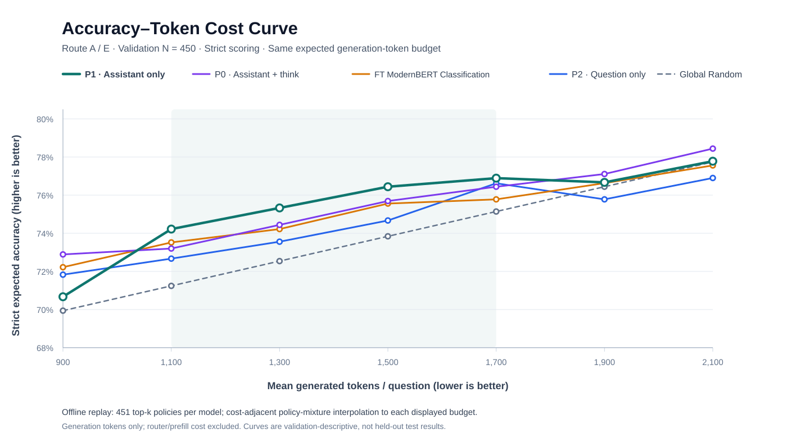

# Route E — Frozen Representations for Adaptive Reasoning Routing

**Last updated:** 2026-11-03 · **Repository:** [AdaptThink](../README.md) · **Status:** frozen-encoder comparison, prefix ablation, and dense equal-budget validation completed; server-only verification logs should be retained with the experiment artifacts.

This is the **single source of truth** for Route E, combining the earlier frozen-probe plan, P0/P1/P2 prompt-prefix ablation protocol, and equal-generated-token analysis. Historical Route A results remain in [ROUTE_A_PLAN.md](ROUTE_A_PLAN.md); Route B is independent.

**Research question:** Can a frozen reasoning model’s pre-generation hidden state encode more useful information for choosing Thinking vs NoThinking than a frozen general-purpose text encoder, and how sensitive is that information to the prompt suffix?

### Results at a glance

| Encoder / prompt | Val AUC | 50% NoThinking accuracy | Mean output tokens | Budget-matched Random uplift |
| --- | ---: | ---: | ---: | ---: |
| Frozen ModernBERT, CLS | 0.4843 | 72.22% | 1,285.8 | -0.22 pp |
| Frozen DeepSeek P0 — Assistant + `<think>` | 0.5823 | 74.67% | 1,348.2 | +1.82 pp |
| **Frozen DeepSeek P1 — Assistant only** | **0.6110** | **76.44%** | 1,427.0 | **+3.08 pp** |
| Frozen DeepSeek P2 — question only | 0.5728 | 74.22% | 1,421.5 | +0.90 pp |
| Full FT ModernBERT Classification (historical) | — | 73.56% | ~1,092 | +2.37 pp |

At common *expected mean generated-token* budgets, P1 leads at 1,100–1,700 tokens; P0 leads at 900, 1,900 and 2,100. These are **descriptive strict validation** results, not held-out tests or end-to-end efficiency measurements.



## 1. Research design and controlled comparison

**Can pre-generation representations from the frozen
DeepSeek-R1-Distill-Qwen-1.5B model improve cost-matched routing over frozen
ModernBERT-base representations?** The first pass varies *only the encoder*:

| Arm | Input / feature | Parameters updated | Prediction |
| --- | --- | --- | --- |
| A (historical reference) | ModernBERT-base fine-tuned with classification | Full encoder + head | NoThinking score |
| B (new) | Frozen ModernBERT-base, first-token/CLS hidden vector | Logistic head only | P(NoThinking) |
| C (new) | Frozen DeepSeek 1.5B, last prompt-token hidden vector | Logistic head only | P(NoThinking) |

Arms B and C use the identical **hard binary supervision**,
**full-batch logistic BCE + L2**, and the existing Route A cost-matched
evaluation code. A is a system-level reference, not a strict frozen-only
ablation. Optional TF-IDF baseline and layer/pooling sweeps are deferred.

Classification target (NoThinking = 1, ties go to NoThinking):
`y = 1[p_nothinking_strict >= p_thinking]`.
No regression labels, lambda, oracle feature, solution, future output length,
generated answer, or NoThinking/Thinking result is used as router input.
The DeepSeek weights are not updated, nor are generated answers repeated.

## 2. Data protocol, leakage prevention, and representation extraction

The script hard-fails unless the original strict source SHA256 matches:

| Split | File | Count | Expected SHA256 |
| --- | --- | ---: | --- |
| Train | results/router_labels_1p5b/all_3000_labels.jsonl | 3000 | 761dcbb6338de1a3c71def382089c83e8024e0e55af6334dd974963e8d7e0f2c |
| Validation | results/val_450_labels.jsonl | 450 | 4c1e984d3744cc089dcc963a30af0ef3d1ed9808c4bfd245a97e48787d501461 |

The original strict train file is **not tracked on current main**; see
[Route A restoration instructions](ROUTE_A_PLAN.md#6-reproducing-route-a-experiments-on-ntu-tc1).
Do not substitute the 2,777 compliant examples or repaired results.
The 450 validation examples consist of GSM8K 300 and MATH-500 150.
The script shares `read_labels`, `curve_point`, `endpoints`, and
budget-matched Global Random logic with `scripts/train_modernbert_delta.py`.
For validation, that loader uses `p_nothinking_strict` if present and
otherwise the stored strict `p_nothinking`, consistent with Route A.
The canonical 485-example test set is not read or accessed by these scripts;
do not use it for layer, classifier, or hyperparameter decisions.

The script reports sample-ID overlap and normalized exact text overlap
between train/validation (the latter is disclosed rather than silently
deleting examples, to preserve Route A's fixed protocol). Train and
validation feature caches carry their original strict file SHA256.
No silent dropping, no hidden truncation: an overlength prompt raises an
error with the offending example ID. Increase `--max-length` if necessary,
using the same maximum for B and C.

### Feature extraction / linear probe

- **ModernBERT**: use original `answerdotai/ModernBERT-base` weights
  and raw question text, encode with `AutoModel`, take first/CLS token vector.
- **DeepSeek**: use the frozen server-local
  `model/DeepSeek-R1-Distill-Qwen-1.5B` backbone (`AutoModel`),
  user chat template + generation prompt, take the last real prompt token.
  This performs prefill **only** and never decodes a token.
- Both are evaluated with right padding and attention mask, FP16 on the
  single V100, `max_length=1024` (error if exceeded),
  batch size 8 (adjust via Slurm env vars). Both embeddings are cached as
  Float16 without labels or responses; records contain sample IDs and metadata.
- **Head**: standardize features using training-only means/stds; one
  affine score + sigmoid, full-batch hard-label BCE + coefficient `1e-3`
  times squared L2 norm of weights, trained with CPU LBFGS for at most
  200 iterations, with zero initialization. No selection on validation AUC.
- **Evaluation**: rank by predicted P(NoThinking), send the top fraction
  to NoThinking, replay per-question frozen-mode empirical success rates
  and token costs using Route A's `curve_point`. Shares:
  0%, 10%, 25%, 50%, 75%, 100%; reports overall, GSM8K, and MATH.
  Compare **uplift against Random at the same observed mean generated tokens**,
  not at the same NoThinking share. AUC is diagnostic only.
- **Overhead**: cache records tokenization, per-question GPU forward
  time, complete extraction time, and batch CPU head latency separately.
  Generated-token curve **does not include router overhead**. Decoder
  backbone prefill is extra work unless a compatible inference stack
  explicitly proves safe reuse. Do not claim zero overhead or automatic
  KV-cache reuse.
- No gradient updates to either encoder; no alternative loss,
  data split, label repair, or test-driven tuning in this phase.

## 3. DeepSeek prompt-prefix ablation (P0 / P1 / P2)

The official **DeepSeek-R1-Distill-Qwen-1.5B** tokenizer template
inserts `<｜Assistant｜><think>\n` when
`add_generation_prompt=True`. False leaves only the rendered user message.

| Arm | Encoding / final prompt content | Status |
| --- | --- | --- |
| P0 | official user chat prompt + `<｜Assistant｜><think>\n` | Existing DeepSeek Full, no new extraction |
| P1 (`assistant`) | official user chat prompt + `<｜Assistant｜>` | New: isolate `<think>\n` effect |
| P2 (`user_only`) | official user chat prompt; `add_generation_prompt=False` | New: remove full assistant prefix |

The new script derives P1 from the *loaded tokenizer's* P2 and checks
that P0 exactly equals `P2 + <｜Assistant｜><think>\n`.
If the local model's template differs from the expected official form,
**execution fails before loading the transformer model**. It also verifies
that tokenize=False followed by tokenization without extra special tokens
matches Hugging Face's direct `tokenize=True` pathway.

These are three different *input-position representations*, not claims
about what reasoning the model actually performed. All are **prefill only**,
28-layer backbone final hidden state / last real prompt token (1536 dims),
without generating answers.

### Controlled variables

- Same original strict 3,000-question training set and 450-question validation set
  with hard labels `1[p_nothinking_strict >= p_thinking]`.
- Same local DeepSeek checkpoint, `AutoModel`, FP16, right padding,
  maximum 1024 input tokens (no silent truncation), and batch size 8.
- Same P0 linear logistic regression implementation from
  `scripts/route_e_frozen.py`, with train-only standardization,
  L2 coefficient `1e-3` and LBFGS at most 200 iterations.
- Same P0 ranking protocol and strict Route A cost-matched Global Random
  evaluation from `scripts/train_modernbert_delta.py`.
- Same 0%, 10%, 25%, 50%, 75%, and 100% NoThinking fractions.
- No use of canonical test data; no label repair, cost-aware training,
  generation, or encoder parameter updates.

Note: because the final token itself changes between P0/P1/P2,
differences cannot automatically be attributed to intrinsic model
reasoning ability or model-internal preference. The study measures
representation sensitivity to prompt prefixes.

## 4. Completed validation results

| Route E encoder / prompt | Validation AUC (diagnostic) | Accuracy at 50% NoThinking | Mean generated tokens | Uplift vs its budget-matched Global Random |
| --- | ---: | ---: | ---: | ---: |
| Frozen ModernBERT-base, CLS | 0.4843 | 72.22% | 1,285.8 | -0.22 pp |
| Frozen DeepSeek P0: Assistant + `<think>` | 0.5823 | 74.67% | 1,348.2 | +1.82 pp |
| **Frozen DeepSeek P1: Assistant only** | **0.6110** | **76.44%** | 1,427.0 | **+3.08 pp** |
| Frozen DeepSeek P2: User/question only | 0.5728 | 74.22% | 1,421.5 | +0.90 pp |
| Full fine-tuned ModernBERT Classification (historical reference) | Not recorded here | 73.56% | 1,092 (rounded) | +2.37 pp |

P0 is the final valid prompt-token hidden state after adding
`<｜Assistant｜><think>\n`, P1 removes only `<think>\n`, and P2 removes
the entire Assistant generation prefix. All three use the frozen DeepSeek
model's final-layer representation (1,536 dimensions), with no generation
before routing. At a *common 50% NoThinking share*, the mean generation
token budgets differ, so these rows alone **must not** be interpreted as
a fixed-cost ranking. AUC assesses noisy binary-label separation, **not**
routing efficiency or statistical significance.

### Accuracy–Token Curve — same expected generation budget


*Figure: Strict 450-example validation; higher accuracy and fewer
generated tokens are better. Every Router is evaluated at the same
**expected mean generated-token budget**. The plotted points use the
saved 450 per-question scores for the four Routers, not the earlier
six-point Classification approximation. Generation-only token costs
exclude Router prefill/inference overhead.*

| Common budget (tokens / question) | Global Random | FT Classification | P0 + think | P1 Assistant | P2 Question | P1 - FT (pp) |
| ---: | ---: | ---: | ---: | ---: | ---: | ---: |
| 900 | 69.94% | 72.22% | **72.89%** | 70.67% | 71.83% | -1.55 |
| 1,100 | 71.24% | 73.52% | 73.20% | **74.22%** | 72.67% | +0.70 |
| 1,300 | 72.54% | 74.22% | 74.44% | **75.33%** | 73.56% | +1.11 |
| 1,500 | 73.84% | 75.56% | 75.69% | **76.44%** | 74.67% | +0.89 |
| 1,700 | 75.14% | 75.78% | 76.44% | **76.89%** | 76.62% | +1.11 |
| 1,900 | 76.44% | 76.63% | **77.11%** | 76.67% | 75.78% | +0.04 |
| 2,100 | 77.74% | 77.56% | **78.44%** | 77.78% | 76.90% | +0.22 |

**Interpretation:** P1 has the highest observed accuracy at the four
listed budgets from **1,100 through 1,700** tokens (its advantage over
FT Classification is **+0.70 to +1.11 pp**). P0 performs better at
900, 1,900, and 2,100. This is **budget-dependent**; no representation
uniformly dominates. P1's average advantage at the four middle
reporting budgets is **+0.95 pp** (descriptive only).

**Cost-matching method:** for each Router, rank validation questions
using only its saved pre-generation scores and evaluate all
`k = 0..450` top-`k` NoThinking routing policies. Policies are
sorted by their *measured validation* mean generated-token cost; the
two cost-adjacent policies are mixed at each reporting budget,
giving an exact **expected mean token budget** in the offline
replay. The policy mixture is **not** an accuracy-maximizing
oracle or proof that the same cost will hold online. The dense
Classification source is
`outputs/external_modernbert/classification/val_predictions.jsonl`.
All four dense score sets passed 450-ID coverage checks in the
server-side comparison. The remaining historical 50% NoThinking
reproduction check is described below.

## 5. Dense equal-budget evaluation protocol

To compare P0/P1/P2 and Full FT Classification under budget B, rank
questions by router score (higher means prefer NoThinking). Evaluate
**each prefix k in 0..450**: route precisely those top k questions to
NoThinking, the others to Thinking. Record measured mean strict
answer success and generated tokens. This is a dense 451-point curve,
not merely six fractions.

For an exact expected mean budget B between the observed mean-token
costs of two policies, interpolate via a **randomized mixture of those
two policies**. The evaluation script sorts policies by measured
generated tokens and interpolates adjacent cost points. It does not
select an accuracy-maximizing envelope (which would be overly optimistic
on validation). Report the mixture probabilities along with the expected
accuracy. The interpolation is between **complete router policies**,
not between ground-truth answers or an oracle per-question selector.

**Important limitations**
- This is an offline replay on the validation set. Choice of a routing
  threshold or mixture from observed validation *token costs* is
  descriptive and must not be presented as a test-time deployment
  policy with prior knowledge of future output lengths.
- No router compute/prefill overhead is included.
- Accuracy is an empirical average of cached per-mode success rates.
  It is not necessarily a realized accuracy on a single sampled decode.
- The canonical held-out test set must not be used for tuning.
- Curves can be nonmonotonic in accuracy and occasionally mean token cost;
  interpolation between cost-adjacent policies is a mathematically valid
  randomized policy but not necessarily a single deterministic top-k rule.
- Tiny differences require paired uncertainty estimates before
  significance claims.

### Classification score source and fallback

The previously recorded classification aggregate shares have budgets:
0%=2209; 10%=1959; 25%=1542; 50%=1092; 75%=835;
100%=567.6. These are sufficient to form only an **approximate,
six-anchor interpolated Classification line**. They are not the
451-point dense exact Classification curve.

If the server has raw Classification per-question predictions, rerun
with their real path and explicit field/score direction, for example:

```bash
# First inspect available files; do not guess a prediction schema.
find outputs/external_modernbert results/external_modernbert -type f \
  \( -iname '*prediction*' -o -iname '*score*' \) | sort

# Hypothetical case (only if JSONL actually contains this field):
python scripts/route_e_equal_budget.py \
  --classification-scores outputs/external_modernbert/classification/val_predictions.jsonl \
  --classification-score-field predicted_p_nothinking \
  --classification-score-direction higher_nt

# If classification score is a Thinking-benefit margin instead:
python scripts/route_e_equal_budget.py \
  --classification-scores path/to/classification_validation_scores.jsonl \
  --classification-score-field predicted_delta \
  --classification-score-direction lower_nt
```

Supported input forms:
1. JSON: `{"p_nt":{"sample_id":score,...}}`, or bare
   `{"sample_id":score,...}`;
2. JSONL: one record per sample with `sample_id` and the specified
   `--classification-score-field`.

The script asserts exact coverage of all 450 strict validation IDs,
rejects duplicates and nonfinite scores, and labels which methods
used dense versus coarse evidence. **Do not treat a 0/1 hard class
prediction as the intended ranked score** if continuous logits or
probabilities are available.

If Classification scores are missing, do **not** claim the four-model
table is uniformly exact. The report prints:

`FT_CLASSIFICATION_SOURCE=APPROXIMATE_SIX_ANCHORS`.

Once true scores are supplied, it prints:

`FT_CLASSIFICATION_SOURCE=DENSE_SCORES`.

## 6. Classification 50%-NoThinking baseline reproduction

The recorded Full-FT Classification baseline at 50% NoThinking (top 225 of 450 validation questions) is **73.56% accuracy (331/450) at about 1,092 mean generated tokens**. The analysis script includes a mandatory gate: it reconstructs that top-225 policy using the saved continuous Classification scores, fails if accuracy differs by over 0.03 percentage points or tokens differ by over 2, and records the result in JSON.

The user reports that verification was completed; the exact `FT_CLASSIFICATION_50PCT_PASS` log and score-field orientation are not included in this checked-in document. Retain those server-side artifacts for auditing; do **not** invent a precise reproduction value.

```bash
# CPU only; choose FIELD and DIRECTION from the actual saved JSONL schema.
python scripts/route_e_equal_budget.py --self-test
python scripts/route_e_equal_budget.py \
  --classification-scores outputs/external_modernbert/classification/val_predictions.jsonl \
  --classification-score-field FIELD \
  --classification-score-direction DIRECTION
# Expected: FT_CLASSIFICATION_50PCT_PASS ... and FT_CLASSIFICATION_SOURCE=DENSE_SCORES
```

The historical dense-score comparison used all 450 IDs but is separate from the reproduction gate. Never switch score orientation just to obtain a desired performance result.

## 7. NTU reproduction runbook

All training/evaluation jobs used one Tesla V100-32GB; no held-out test set was used. The branch-specific commands below are rewritten for the unified `main` branch. **Do not rerun completed expensive experiments unless needed.**

### Frozen ModernBERT and Frozen DeepSeek (historical execution)

First inspect the working tree and preserve the server's restored untracked
strict labels before pulling. Switch to the experiment branch without deleting
or overwriting Route B artifacts.

```bash
cd /tc1home/UG/n2602710a/AdaptThink
git status --short
git fetch origin
git switch main
git pull --ff-only origin main
source .venv/bin/activate
python scripts/route_e_frozen.py self-test
python scripts/route_e_frozen.py check-data

# First: two separate small smoke tests (32 train + 24 validation)
sbatch --export=ALL,E_ENCODER=modernbert,E_SMOKE=1 scripts/ntu_route_e.sbatch
# After the first job finishes, separately:
sbatch --export=ALL,E_ENCODER=deepseek,E_SMOKE=1 scripts/ntu_route_e.sbatch

# Once both smoke jobs pass, launch full extraction + probe, sequentially:
sbatch --export=ALL,E_ENCODER=modernbert,E_SMOKE=0 scripts/ntu_route_e.sbatch
# After completion:
sbatch --export=ALL,E_ENCODER=deepseek,E_SMOKE=0 scripts/ntu_route_e.sbatch
```

To inspect results:
```bash
squeue -u "$USER"
# Substitute actual job ID
sacct -j JOBID --format=JobID,State,Elapsed,ExitCode
grep -E "ROUTE_E_VAL|ROUTE_E_FULL_VALIDATION|FEATURES_SAVED|ROUTE_E_DONE" route_e_JOBID.out
```

Jobs are independent, use one GPU, and have a default four-hour walltime.
If there is a CUDA OOM, lower `E_BATCH_SIZE` (e.g. 4); if max token length
is rejected, raise `E_MAX_LENGTH` consistently for B and C. This must
create a separate feature cache/configuration, not silently reuse an older
incompatible one. To replace failed partial outputs, use the extractor
`--overwrite` option deliberately after inspecting the files.

### Prompt-prefix P1/P2 (historical execution)

**First finish P0 ModernBERT Full, then P0 DeepSeek Full**, on the existing
`feature/route-e-frozen-probes-20261102` branch. Never run the two jobs
simultaneously under the single-GPU quota. Confirm both logs and
saved P0 result files.

After both have finished, switch branches:

```bash
cd /tc1home/UG/n2602710a/AdaptThink
git status --short
git fetch origin
git switch main
git pull --ff-only origin main
source .venv/bin/activate

# Check exact local tokenizer template BEFORE GPU feature extraction
python scripts/route_e_prompt_ablation.py self-test
python scripts/route_e_frozen.py check-data
python scripts/route_e_prompt_ablation.py inspect-template

# Then submit one GPU job at a time
sbatch --export=ALL,E_PREFIX=assistant,E_SMOKE=1 scripts/ntu_route_e_prefix.sbatch
# after first smoke finishes:
sbatch --export=ALL,E_PREFIX=user_only,E_SMOKE=1 scripts/ntu_route_e_prefix.sbatch

# Once both smoke jobs pass (sequentially):
sbatch --export=ALL,E_PREFIX=assistant,E_SMOKE=0 scripts/ntu_route_e_prefix.sbatch
# after full P1 job finishes:
sbatch --export=ALL,E_PREFIX=user_only,E_SMOKE=0 scripts/ntu_route_e_prefix.sbatch
```

Outputs do **not** overwrite P0:
- `outputs/route_e/deepseek/full/{train,val}.npz` (P0, unchanged)
- `outputs/route_e/prompt_ablation/assistant/{smoke,full}/` (P1)
- `outputs/route_e/prompt_ablation/user_only/{smoke,full}/` (P2)
- `results/route_e/prompt_ablation/{assistant,user_only}_{smoke,val}.json/.csv`

The extractor refuses to overwrite a cache. For failed partial jobs,
inspect or remove the specific output files explicitly before re-running.
Input file SHA256, model path, tokenizer template SHA256, actual token
lengths and timing data are saved in each cache's metadata. The first
GPU forward batch is recorded separately from post-first-batch throughput.
Neither timing metric includes model load time or establishes a real-world
single-query serving latency.

### Equal-budget replay (CPU; no GPU)

```bash
cd /tc1home/UG/n2602710a/AdaptThink
git status --short
git fetch origin
git switch main
source .venv/bin/activate

python scripts/route_e_equal_budget.py --self-test
python scripts/route_e_equal_budget.py
```

The default command reads only:
- `results/val_450_labels.jsonl` (validated strict SHA256);
- `outputs/route_e/deepseek/full/validation_p_nt.json` (P0);
- `outputs/route_e/prompt_ablation/assistant/full/validation_p_nt.json` (P1);
- `outputs/route_e/prompt_ablation/user_only/full/validation_p_nt.json` (P2).

It creates:
- `results/route_e/budget_comparison/equal_budget.json` (metadata,
  exact budget-point mixtures, classification-source status);
- `results/route_e/budget_comparison/equal_budget.csv` (summary table).

Default common budgets: 900, 1100, 1300, 1500, 1700, 1900, 2100
mean generated tokens per question.

Report cost-matched Random uplift at *each actual output-token budget*,
full Accuracy–Token curves for overall, GSM8K and MATH-500,
and timing/latency caveats. Keep validation AUC only as a diagnostic.
P0 vs P1 isolates the Thinking prefix; P1 vs P2 isolates the Assistant
prefix; P0 vs P2 is their combined effect. No canonical test-based tuning.

## 8. Artifact locations and interpretation

| Artifact | Path |
| --- | --- |
| Frozen train/validation features | outputs/route_e/{modernbert,deepseek}/{smoke,full}/{train,val}.npz |
| Logistic probe weights and scaler | outputs/route_e/{encoder}/{smoke,full}/linear_probe.npz |
| Validation predicted NoThinking scores | outputs/route_e/{encoder}/{smoke,full}/validation_p_nt.json |
| Accuracy–Token full report | results/route_e/{encoder}_val.json, .csv |
| Smoke-only report | results/route_e/{encoder}_smoke.json, .csv |

Large embeddings and weights live under ignored `outputs/`; do not commit
them. The compact `results/route_e/` files may be committed **after**
completed full runs. The smoke report is not a final validation result.

At the common *50% NoThinking share*, historical full-fine-tuned
Classification had **73.56% accuracy, 1,092 output tokens, +2.37 pp vs
cost-matched Global Random**; compare both new arms at their individually
measured token budgets. Do not assert a clear encoder winner solely from
different 50%-share accuracies. Prefer the whole curve and common-budget
comparison, and keep extraction/forward latency visible. Repeated runs or
bootstrap confidence intervals are advisable before claiming small gains.

### Caveats and follow-ups

1. A strict encoder B/C comparison uses identical labeled questions,
   head, penalty, routing policy and evaluation, but their tokenization
   and native representation position necessarily differ.
2. The small labeled sample and ties in empirical success rates motivate
   frozen probes but do **not** establish full fine-tuning overfit.
3. Prefill representation generation cost and communication overhead may
   dominate a small-model serving deployment; measure end-to-end latency
   before translating output-token savings into speedups.
4. Record actual GPU/software environment, ModernBERT checkpoint
   revision (cached Hugging Face revision), and DeepSeek checkpoint
   provenance in the completed experiment log.
5. If both frozen probes lose, first inspect calibration, representation
   quality, label noise, and linear separability; MLPs, layer sweeps, and
   altered objectives belong to **later** experiments, not this control.

## 9. Maintainer notes

- The original three separate files (frozen probe, prefix ablation, and equal-budget report) were consolidated into **this file** to avoid maintaining overlapping protocols.
- Keep [ROUTE_A_PLAN.md](ROUTE_A_PLAN.md) as the historical record for the original five ModernBERT objectives and the shared chart.
- The comparison uses empirical strict success rates and **mean generated-token budgets only**. DeepSeek encoder prefill is additional computation because `use_cache=False`; measuring real deployment latency and doing paired uncertainty analysis remain future work.
- The prior six-anchor Classification interpolation is superseded by **450-score dense replay**; it should not be cited as the final accuracy–token curve.
